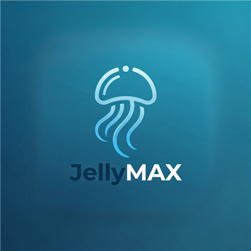

<p align="center">
  
</p>

<h1 align="center">JellyMax</h1>

<p align="center">
  Un client <a href="https://jellyfin.org">Jellyfin</a> pour Windows, au design inspiré de HBO Max.
</p>

---

## Fonctionnalités

- **Plusieurs profils** : ajoutez autant de comptes que vous voulez, même sur des serveurs différents, puis choisissez-en un au lancement (« Qui regarde ? »). Vous pouvez aussi ouvrir directement le dernier profil utilisé.
- **Avatars synchronisés** : choisissez votre avatar dans la galerie de votre serveur Jellyfin (plugin [GetAvatar](https://github.com/cedev-1/jellyfin-plugin-GetAvatar)) ou importez une image. L'avatar devient votre photo de profil Jellyfin, partout.
- **Accueil** : grande bannière, Reprendre la lecture, À suivre, recommandations basées sur ce que vous avez regardé, nouveautés, Ma liste, mieux notés, genres.
- **Films et Séries** : reprise, recommandations, nouveautés, un carrousel par genre, puis le catalogue complet avec tri, filtres et genres.
- **Recherche** dans tout le catalogue : films, séries, épisodes, collections, acteurs et genres.
- **Ma liste** : vos médias favoris.
- **Lecteur** :
  - lecture directe, remux ou transcodage décidés par le serveur selon les codecs de votre PC (H.264, HEVC, AV1, VP9…), avec repli automatique en cas d'échec ;
  - pistes audio, sous-titres et qualité ;
  - « Passer l'intro » et « Épisode suivant » ;
  - aperçus d'images sur la barre de progression ;
  - reprise synchronisée avec le serveur.
- **Sous-titres personnalisables** : taille, couleur, fond, contour, position et police.
- **Français et anglais**.

Nécessite **Jellyfin 10.9 ou plus récent**.

## Installation

Téléchargez l'installeur `JellyMax-Setup-x.y.z.exe` (ou la version portable) depuis la page *Releases*, puis lancez-le.

L'application n'étant pas signée, Windows SmartScreen peut afficher un avertissement : cliquez sur *Informations complémentaires* puis *Exécuter quand même*.

Au premier lancement, saisissez l'adresse de votre serveur Jellyfin (par exemple `http://192.168.1.20:8096`) puis connectez-vous.

## Raccourcis

| Touche | Action |
| --- | --- |
| Espace / K | Lecture / pause |
| ← / → | Reculer / avancer de 10 s |
| ↑ / ↓ | Volume |
| F | Plein écran du lecteur |
| M | Couper le son |
| Échap | Quitter le lecteur |
| F11 | Plein écran de l'application |

## Développement

Prérequis : [Node.js](https://nodejs.org) 20 ou plus récent.

```powershell
npm install
npm run dev        # application Electron avec rechargement à chaud
npm run dist       # installeur + version portable dans release/
```

### Structure

```
electron/          processus principal (fenêtre, plein écran, anti-veille)
src/api/           client Jellyfin, profil de lecture, recommandations
src/components/    interface (barre latérale, carrousels, cartes, avatars…)
src/pages/         écrans (profils, accueil, films, séries, fiche, lecteur…)
src/state/         profils et paramètres
src/i18n.ts        traductions français / anglais
```

## Vie privée

JellyMax ne contient aucune donnée de serveur ou d'utilisateur. Les adresses de serveur, les profils et les jetons de connexion sont stockés uniquement sur votre PC, dans le dossier de données de l'application (`%APPDATA%\JellyMax`). L'application ne communique qu'avec les serveurs Jellyfin que vous ajoutez.

---

JellyMax est un projet indépendant, sans lien avec Jellyfin ni avec HBO Max. Distribué sous licence [MIT](LICENSE).
