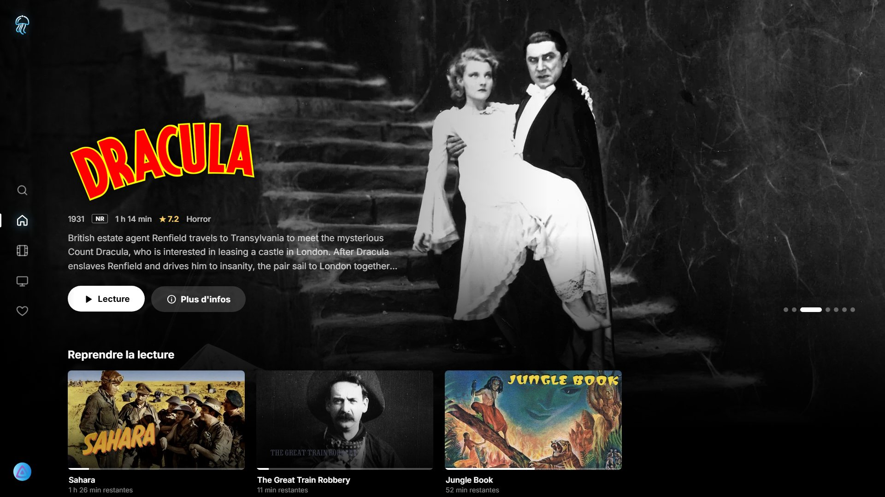
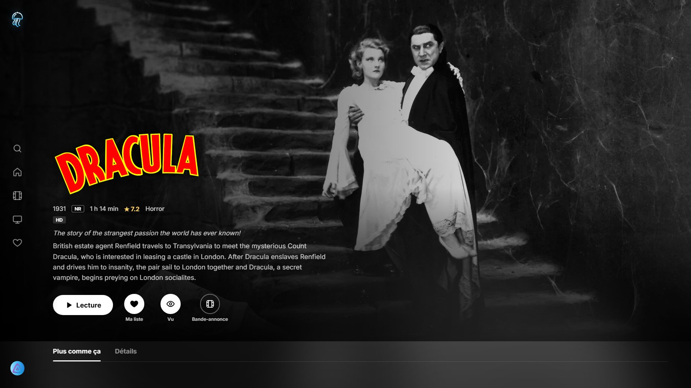
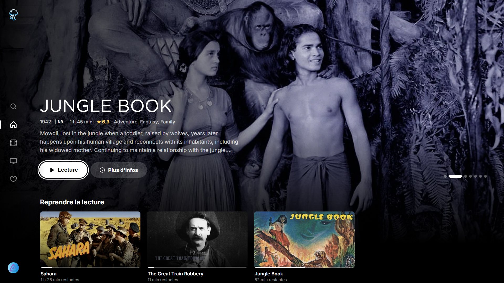
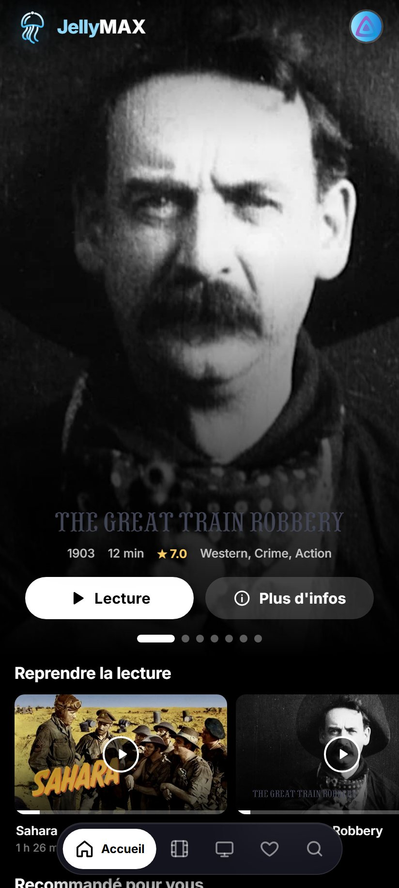
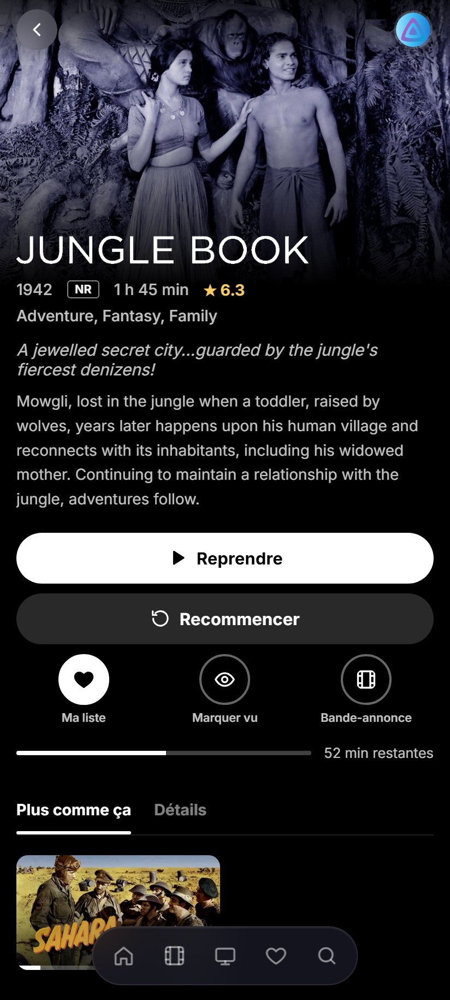

<p align="center">
  
</p>

<h1 align="center">JellyMax</h1>

<p align="center">
  An HBO Max-inspired <a href="https://jellyfin.org">Jellyfin</a> client for Windows, Android (phones and tablets) and Samsung TVs (Tizen).
</p>

---

## Screenshots

<p align="center">
  
</p>

<p align="center">
  
  
</p>

<p align="center">
  
  
</p>

<p align="center"><sub>Windows home screen, movie page on Windows, Samsung TV home screen, and the Android app. Shown with the public-domain movies of the <a href="https://demo.jellyfin.org/stable">Jellyfin demo server</a>.</sub></p>

## Features

- **Multiple profiles**: add as many accounts as you like, even on different servers, and pick one at launch ("Who's watching?"). You can also skip the picker and reopen the last profile.
- **Synced avatars**: choose your avatar from your Jellyfin server's gallery ([GetAvatar](https://github.com/cedev-1/jellyfin-plugin-GetAvatar) plugin) or upload an image (Windows). It becomes your Jellyfin profile picture everywhere.
- **Home**: large hero banner, Continue Watching, Next Up, recommendations based on what you watched, new releases, My List, top rated, genres.
- **Movies and Shows**: continue watching, recommendations, new releases, one row per genre, then the full catalog with sorting, filters and genres.
- **Search** across the whole library: movies, shows, episodes, collections, people and genres.
- **My List**: your favorites.
- **Player**:
  - direct play, remux or transcode, chosen by the server based on what the device can decode (H.264, HEVC, AV1, VP9…), with automatic fallback on failure;
  - audio, subtitle and quality selection;
  - "Skip intro" and "Next episode";
  - trickplay thumbnails on the seek bar;
  - playback position synced with the server.
- **Customizable subtitles**: size, color, background, outline, position and font.
- **French and English**.

Requires **Jellyfin 10.9 or newer**.

## Windows

### Install

Download `JellyMax-Setup-x.y.z.exe` (or the portable version) from the *Releases* page and run it.

The app is not code-signed, so Windows SmartScreen may show a warning: click *More info* then *Run anyway*.

On first launch, enter your Jellyfin server address (for example `http://192.168.1.20:8096`) and sign in.

### Keyboard shortcuts

| Key | Action |
| --- | --- |
| Space / K | Play / pause |
| ← / → | Back / forward 10 s |
| ↑ / ↓ | Volume |
| F | Player fullscreen |
| M | Mute |
| Esc | Exit the player |
| F11 | App fullscreen |

## Android (phones and tablets)

### Install

Download `JellyMax-x.y.z.apk` from the *Releases* page on your phone or tablet and open it. Android will ask you to allow installing apps from your browser or file manager the first time. Requires Android 6.0 or newer with an up-to-date Android System WebView.

To update, install the newer APK over the existing one: your profiles and settings are kept.

### Designed for touch

- Bottom tab bar (Home, Search, Movies, Shows, My List, Profile) within thumb reach.
- Layouts adapted to phones (portrait and landscape) and tablets.
- Touch player: tap to show or hide the controls, double-tap the left or right side to skip back or forward 10 s (keep tapping to skip more), large seek bar.
- Playback switches to full-screen landscape, hides the system bars and keeps the screen on.
- Android Back button: closes menus and panels, leaves the player, goes back, then returns to Home and exits.
- Lightweight: about 2 MB, with heavy visual effects reduced and off-screen rows skipped.

## Samsung TV (Tizen)

Supports Samsung TVs from **2020 onwards** (Tizen 5.5+). The interface is fully usable with the remote: arrows to move, OK to select, Back to go back (Back on the first screen closes the app). In the player, ◀ / ▶ skip 10 s when the controls are hidden; the play/pause, stop, rewind and fast-forward keys are supported.

### Install on your TV

Samsung only allows apps from outside the store to be installed in developer mode, signed with your own certificate.

1. **Enable developer mode on the TV**: open *Apps*, type `1 2 3 4 5` on the remote, turn *Developer mode* on, enter your PC's IP address, then restart the TV.
2. **Install [Tizen Studio](https://developer.samsung.com/smarttv/develop/getting-started/setting-up-sdk/installing-tv-sdk.html)** with, in the Package Manager, *Samsung Certificate Extension* and the *TV Extensions* tools.
3. **Create a certificate**: in Tizen Studio, *Tools → Certificate Manager → +*, choose *Samsung*, *TV*, then sign in with a Samsung account. Add your TV's DUID (shown when the TV is connected through *Device Manager*).
4. **Sign and install** — either option works:

   **Option A — from the Releases page.** Download `JellyMax-x.y.z.wgt`, then re-sign it with your certificate and install it (replace `MyProfile` with your certificate profile name and the IP with your TV's):

   ```powershell
   cd C:\tizen-studio\tools
   .\sdb.exe connect 192.168.1.50
   .\ide\bin\tizen.bat package -t wgt -s MyProfile -- C:\path\to\JellyMax-1.0.0.wgt
   .\ide\bin\tizen.bat install -n JellyMax-1.0.0.wgt -s 192.168.1.50:26101 -- C:\path\to
   ```

   The `.wgt` on the Releases page is signed with a generic author certificate: it cannot be installed as is, Samsung TVs only accept apps signed with a certificate created for them.

   **Option B — from source.**

   ```powershell
   npm install
   npm run tizen:package                 # builds and signs release/JellyMax-x.y.z.wgt
   npm run tizen:install -- 192.168.1.50 # your TV's IP address
   ```

   If Tizen Studio is not installed in `C:\tizen-studio` or `%USERPROFILE%\tizen-studio`, set the `TIZEN_STUDIO` environment variable. To use a certificate profile other than the active one, set `TIZEN_PROFILE`.

JellyMax then appears in the TV's app list.

## Development

Requirements: [Node.js](https://nodejs.org) 20 or newer.

```powershell
npm install
npm run dev           # Electron app with hot reload
npm run dist          # Windows installer + portable build in release/
npm run build:tizen   # Samsung TV app in dist-tizen/
npm run android:apk   # Android APK in release/
```

The Android build uses [Capacitor](https://capacitorjs.com) and needs JDK 21 and the Android SDK (platform 35). Release APKs are signed with a key kept outside the repository: create a `keystore.properties` file (`storeFile`, `storePassword`, `keyAlias`, `keyPassword`) in `~/.jellymax/`, or point the `JELLYMAX_KEYSTORE_PROPERTIES` environment variable to it. Without it, an unsigned APK is produced.

### Structure

```
electron/          Windows main process (window, fullscreen, sleep prevention)
tizen/             Samsung TV manifest (config.xml) and icon
android/           Android project (Capacitor), with the native playback plugin
scripts/           dev launcher, Tizen and Android builds and packaging
src/api/           Jellyfin client, device profile, recommendations
src/components/    UI (sidebar, rows, cards, avatars…)
src/pages/         screens (profiles, home, movies, shows, details, player…)
src/nav/           spatial navigation (keyboard and TV remote)
src/state/         profiles and settings
src/i18n.ts        French / English translations
```

All platforms share the same code; the touch layout lives in `src/styles/mobile.css`. The TV build (`vite build --mode tizen`) produces a single classic script targeting the TV browser (Chromium 69+), and adapts the stylesheet for older TVs.

## Privacy

JellyMax ships with no server or user data. Server addresses, profiles and access tokens are stored only on your device (on Windows, in `%APPDATA%\JellyMax`). The app only talks to the Jellyfin servers you add.

---

JellyMax is an independent project, not affiliated with Jellyfin or HBO Max. Released under the [MIT](LICENSE) license.
